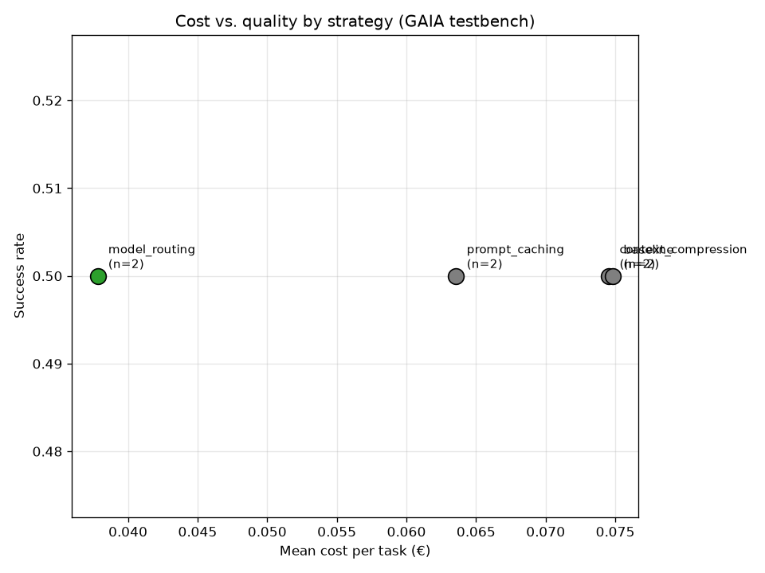

# Testbench: LLM Agent Token Optimization Strategies

> Empirical part of my master's thesis at Aalto University.

Empirical part of a master's thesis. Runs the same GAIA task set under different
token-optimization strategies and measures cost per successful task.

## Key findings

Pilot results so far (24-task GAIA sample is defined; only a handful of runs completed, so **n = 3 per strategy, 1 for `context_isolation`**). Directional only, not statistically meaningful. Produced by `analyze.py` from `results/`.

| Strategy | Runs | Mean cost (EUR) | Success | EUR per success |
|---|---|---|---|---|
| `model_routing` | 3 | 0.0285 | 33 % | 0.0855 |
| `context_isolation` | 1 | 0.0350 | 0 % | n/a |
| `prompt_caching` | 3 | 0.0500 | 33 % | 0.1499 |
| `context_compression` | 3 | 0.0580 | 33 % | 0.1740 |
| `baseline` | 3 | 0.0581 | 33 % | 0.1742 |

- `model_routing` (Haiku first, escalate to Sonnet if unsure) is about half the cost of `baseline` at the same pilot accuracy, and is the only strategy on the Pareto frontier.
- `prompt_caching` is slightly cheaper than `baseline`; `context_compression` is about equal to `baseline` (single-call tasks leave little to compress).
- Haiku's self-reported confidence is poorly calibrated: it was confident but wrong on one task and did not escalate.
- The full comparison (`--repeats 3-5` over all 24 tasks) is the next paid run.



## Setup

```bash
uv sync
cp .env.example .env   # then paste your ANTHROPIC_API_KEY into .env
```

## Run

```bash
uv run run.py --strategy baseline --limit 1              # smoke test, one task
uv run run.py --strategy baseline --max-cost-eur 3       # all 24 tasks
uv run run.py --strategy baseline --repeats 3 --max-cost-eur 10
uv run run.py --strategy baseline --resume results/20260819_150522
```

| Argument | Default | Meaning |
|---|---|---|
| `--strategy` | `baseline` | Which strategy to run (see below) |
| `--tasks` | all | Comma-separated `task_id`s to run a subset |
| `--repeats` | 1 | Runs per task — needed, web search is nondeterministic |
| `--limit` | all | Cap the number of tasks |
| `--max-cost-eur` | 5 | Stop before exceeding this (checked before each task) |
| `--resume` | new dir | Continue an existing results dir instead of starting fresh |

Always smoke-test with `--limit 1` before a large run.

**GAIA ground truth:** answers are not stored in the repo (GAIA asks they are not published in crawlable form). They are loaded at runtime from the gated HF dataset `gaia-benchmark/GAIA`: accept its terms and run `hf auth login` first.

## Analyze

```bash
uv run analyze.py    # reads every results/*/run.jsonl → table + results/pareto.png
```

## Strategies

| Name | Mechanism |
|---|---|
| `baseline` | Full context, native web search, no optimization |
| `prompt_caching` | Top-level `cache_control` auto-caches the message prefix |
| `model_routing` | Haiku answers first; escalate to Sonnet unless it is confident |
| `context_compression` | Native context editing clears old tool results |
| `context_isolation` | Orchestrator splits the question; subagents see only their own subtask |

## Documentation

- **`ARCHITECTURE.md`** — how it works and why: data flow, the shared agent
  loop, each strategy's logic, what is held constant, known limitations.
- **`NOTES.md`** — dated findings and methodological decisions with reasoning.
- **`CLAUDE.md`** — project goals and phasing.

## Models under test

Claude Sonnet 4.5 (primary), Claude Haiku 4.5 (`model_routing` only). Prices in
`config.py` are USD list prices converted to EUR at a fixed rate — verify both
before a real run.

## Safety

Never commit `.env`. Always pass `--max-cost-eur`. Also set a spend limit in the
Anthropic console.
